# LavaTerm

[](https://github.com/ViolaPeracia/ZenLavaTerm/actions/workflows/ci.yml)
[](https://github.com/ViolaPeracia/ZenLavaTerm/releases)
[](LICENSE)
[](https://www.rust-lang.org/)



LavaTerm (`lavaterm`) is a terminal-native ambient lava lamp and metaball visualizer written in Rust. It simulates a 2D scalar potential field with thermal buoyancy and renders sub-cell Unicode graphics in 24-bit True Color.

## Features

- Continuous 2D metaball simulation with thermal buoyancy, viscous damping, boundary reflections, undulating molten bottom pool, and soft ambient edge glow.
- Three terminal renderers: `halfblock` (default), `block`, and `braille` (`U+2800`..`U+28FF`).
- 12 built-in theme presets (`lava`, `ocean`, `cyberpunk`, `synthwave`, `nord`, `forest`, `monochrome`, `matrix`, `sunset`, `dracula`, `catppuccin`, `tokyo-night`), plus `auto`, `pywal`, `wallust`, and custom JSON or TOML palettes.
- System telemetry mode (`--system`) mapping CPU, RAM, and battery state to fluid dynamics.
- FFT audio mode (`--audio`) mapping bass, mid, and treble bands, with Windows WASAPI desktop loopback (`--audio-loopback`) and optional strict capture (`--no-audio-fallback`).
- Display modes for full-screen, `--compact`, `--widget` (15 FPS), `--inline`, `--snapshot`, and `--headless`, plus a toggleable 1-line status HUD (`Ctrl+i` / `Tab`).
- Mouse and keyboard interaction for shockwaves, fluid stirring, thermal pulses, and buoyancy control.

## Requirements

- Rust 1.86+ (`cargo` and `rustc`) when building from source.
- A terminal emulator with 24-bit True Color support (Alacritty, Kitty, WezTerm, Ghostty, Windows Terminal, iTerm2, or modern GNOME Terminal and Konsole).
- A monospace font with Unicode block and Braille glyph coverage.
- On Linux source builds: `libasound2-dev` and `pkg-config` for ALSA audio capture.

## Install

### Pre-built releases

Download standalone installers and archives from [GitHub Releases](https://github.com/ViolaPeracia/ZenLavaTerm/releases):

- Linux: AppImage (`ZenLavaTerm-v<VERSION>-linux-x86_64.AppImage`) or DEB (`ZenLavaTerm-v<VERSION>-linux-x86_64.deb`).
- Windows: MSI installer (`ZenLavaTerm-v<VERSION>-windows-x86_64.msi`).
- macOS: Universal DMG (`ZenLavaTerm-v<VERSION>-macos-universal.dmg`).

### From source

```bash
cargo install --locked --git https://github.com/ViolaPeracia/ZenLavaTerm.git
```

Or build from a local checkout:

```bash
git clone https://github.com/ViolaPeracia/ZenLavaTerm.git
cd ZenLavaTerm
cargo install --path .
```

## Quick start

```bash
# Default lava theme with half-block rendering
lavaterm

# Select a built-in theme preset
lavaterm -t cyberpunk

# Use the 2x4 Braille matrix renderer
lavaterm -r braille

# Drive simulation from OS CPU, RAM, and battery telemetry
lavaterm --system

# Drive simulation from desktop audio (Windows WASAPI loopback)
lavaterm --audio --audio-loopback

# Compact 15 FPS widget mode for panes and sidebars
lavaterm --widget --compact

# Render a single ANSI frame to stdout
lavaterm --snapshot --width 24 --height 8

# Embed a single-line frame in tmux.conf:
# set -g status-right '#(lavaterm --snapshot --width 24 --height 1)'

# Run headless simulation for scripting or CI checks
lavaterm --headless --frames 30
```

## Interactive controls

| Input | Action |
| :--- | :--- |
| `q`, `Q`, `Esc`, `Ctrl+c` | Quit and restore terminal |
| `Space`, `p`, `P` | Pause or resume simulation |
| `r`, `R` | Reset blobs |
| `Ctrl+i`, `Tab` | Toggle 1-line status HUD (mode, audio source, renderer, FPS) |
| `+`, `=`, `Up`, `Right` | Increase buoyancy (+0.1) |
| `-`, `_`, `Down`, `Left` | Decrease buoyancy (-0.1) |
| Left click | Radial shockwave |
| Click and drag | Stir fluid |
| Right click | Thermal pulse |
| Scroll wheel | Vertical convective pressure |
| Typing keys | Harmonic wave ripples |

## Documentation

| Document | Contents |
| :--- | :--- |
| [Configuration](docs/configuration.md) | CLI flags, TOML schema, theme presets, and custom palettes |
| [Architecture](docs/architecture.md) | Data flow, physics model, renderers, audio pipeline, and telemetry |
| [Troubleshooting](docs/troubleshooting.md) | Audio capture, WASAPI loopback, Linux ALSA, macOS permissions, and color fixes |
| [Releasing](docs/releasing.md) | Release process, packaging targets, and verification |
| [Benchmarks](docs/benchmarks/benchmark_baseline.md) | Criterion micro-benchmark baseline measurements |
| [Changelog](CHANGELOG.md) | Release history and unreleased changes |
| [Contributing](CONTRIBUTING.md) | Development setup, validation checks, and PR workflow |

## License

Licensed under the [Apache-2.0 License](LICENSE).
